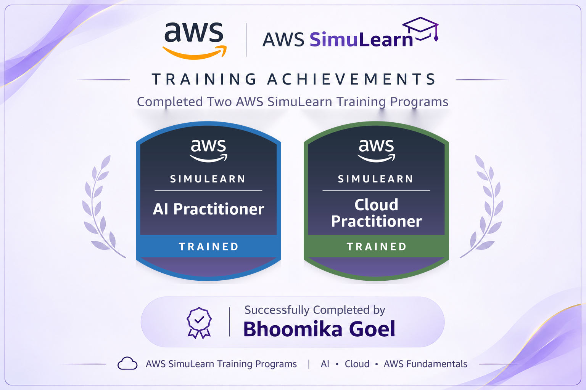

# AWS SimuLearn: AI and Cloud Practitioner

**22 hands-on labs across two training programs, from cloud foundations to AI agents on Amazon Bedrock.**

 

  

## Overview

Each lab is solved against a simulated business brief and reviewed by a simulated stakeholder. This repository hosts the showcase site, which collects the architecture diagrams, stakeholder scores and AWS completion certificates in one place.

| Program | Labs | Credential |
| --- | :---: | --- |
| AWS SimuLearn: AI Practitioner | 10 | [Verify on Credly](https://www.credly.com/badges/fed03bb7-7c41-4398-a712-97a8d20146ff/public_url) |
| AWS SimuLearn: Cloud Practitioner | 12 | [Verify on Credly](https://www.credly.com/badges/fa7498fa-9e35-4082-9926-d24f89306dbe/public_url) |

## Signature builds

| Build | What it demonstrates | Services |
| --- | --- | --- |
| HR agent that takes action | Answers policy questions from a knowledge base and files leave and benefits requests through MCP tools | Bedrock AgentCore, Lambda, DynamoDB |
| Retrieval over real documents | RAG pipeline with embeddings and a vector store | S3, Titan Embeddings, OpenSearch Serverless, Nova Lite |
| AI that follows the rules | Blocks risky topics and redacts personal data before answers reach the user | Bedrock Guardrails |
| Highly available web apps | Load balancing, health checks and scaling across Availability Zones | ELB, Auto Scaling, RDS Multi-AZ, CloudWatch |

## Skills covered

`Prompt engineering` · `RAG` · `AI agents and MCP` · `Responsible AI` · `Serverless` · `VPC networking` · `High availability` · `RDS and DynamoDB` · `IAM least privilege` · `Cost estimation`

## A note on credentials

These are AWS SimuLearn training badges and completion certificates, earned through simulated customer scenarios in live AWS environments. They are not AWS Certification exams.

## Author

**Bhoomika Goel**

[GitHub](https://github.com/bhoomikagoel24) · [LinkedIn](https://www.linkedin.com/in/bhoomikagoel111) · [Portfolio](https://bhoomika-ai-portfolio.vercel.app)